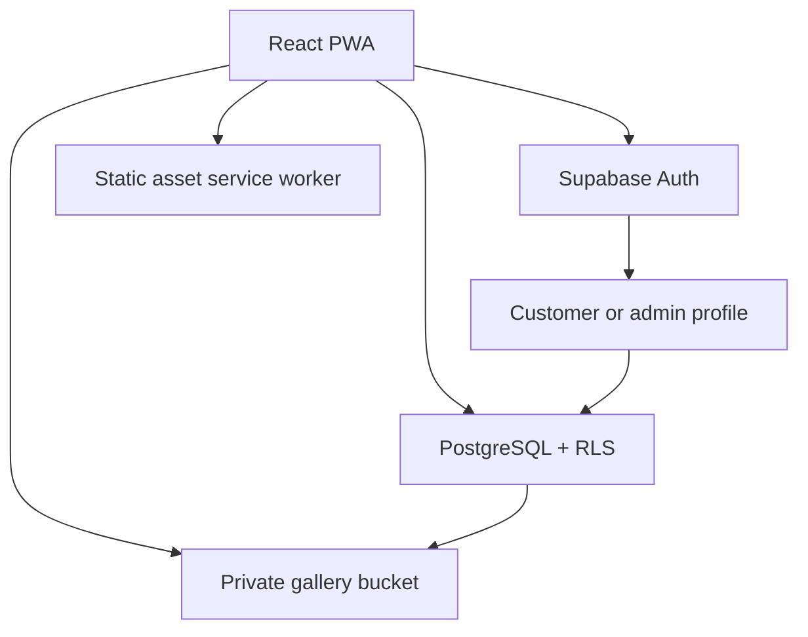

# System architecture

React routes control navigation; Supabase policies control authority. A browser role flag is never
trusted by the production database. Profiles use auth.users UUIDs; email remains in Auth. The signup
trigger forces customer regardless of metadata. Admin provisioning happens through project-owner SQL.

Collections have many photos. Storage keys are collection UUID / photo UUID + extension. All uploaded
photos begin hidden. Both parent and photo must be public for anonymous metadata/object reads.
Storage remains a private bucket; downloads use authenticated Storage API with no-store fetch and
blob object URLs, revoked on component unmount. No long-lived signed/public URLs are generated.
Already downloaded/publicly viewed images cannot be recalled from a viewer's device.

The service worker precaches only build assets and an offline page. It does not intercept Supabase
requests or cache photos, profiles, passwords, sessions or authenticated API responses. Supabase SDK
manages its session token outside Cache Storage; passwords are passed to Auth and never saved by
this app. Offline mutations are not queued. Navigation offline shows a dedicated explanatory page.

Deletion removes storage objects before metadata; errors are visible and retries are possible.
These are multiple service calls, not an atomic database/storage transaction. A partial failure can
leave a metadata row for a removed object; retry deletion. Upload metadata failure triggers best-effort
storage cleanup; investigate orphan files if cleanup fails. Future work can add server-side cleanup
jobs, pagination, thumbnail generation and stronger large-gallery performance controls.

Explicit demo adapter uses IndexedDB and role simulation in sessionStorage. It is browser-only,
modifiable by the user and offers no security boundary. Never deploy it as a production backend.
